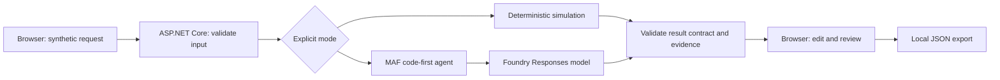

# Architecture and decisions

Audience: developers familiar with basic C# and HTTP who want a first reviewable AI workflow. Learning objective: distinguish model output, application validation and human judgment.

## Decisions

| Decision | Reason and tradeoff |
| --- | --- |
| One agent; no tools | Demonstrates the MAF provider boundary without unnecessary orchestration. Direct model inference would also solve the task; MAF establishes a small learning seam for later examples. |
| Separate simulation | Lets a developer inspect the complete UI with no Azure dependency. Keyword rules are not a model-quality benchmark. In Azure the API rejects simulation, so a hosted run is always live. |
| Strict post-validation | Rejects malformed output, unsupported categories and invented evidence excerpts. Valid structure does not imply correct interpretation. |
| Browser-local review | Makes approval and edited output visible without an external side effect. No persistence, identity or durable audit claim. |
| Static UI served by ASP.NET Core | One application process and no frontend package/build chain. A larger application may need a component framework. |
| Explicit credentials | `FOUNDRY_CREDENTIAL` selects Azure CLI for local development or the web app's system-assigned managed identity in Azure; no API keys. A production system would still need its own identity and access design. |
| App Service with Entra sign-in | Hosts the UI, API and MAF agent in one process on the [lab platform](../../../docs/shared-azure-platform.md), with sign-in limited to an allowlist. MAF runs in the app; this is not a Foundry hosted agent. |

Inputs are untrusted. The live prompt asks the model for JSON; it does not use a model-enforced JSON schema. Invalid JSON fails closed with an error, not simulated fallback. Each request creates a stateless agent invocation; there is no conversation memory.

Preview SDK dependencies are pinned. The live path ran on App Service on 2026-10-14; one run is integration evidence, not a quality measurement. See [verification](verification.md), [Azure deployment](azure-deployment.md) and the [sample guide](../README.md).
