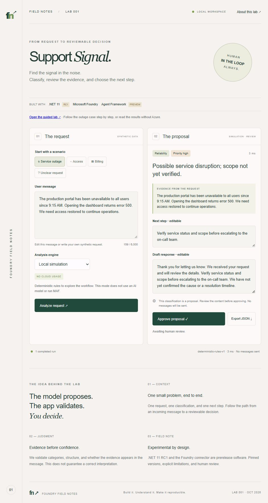
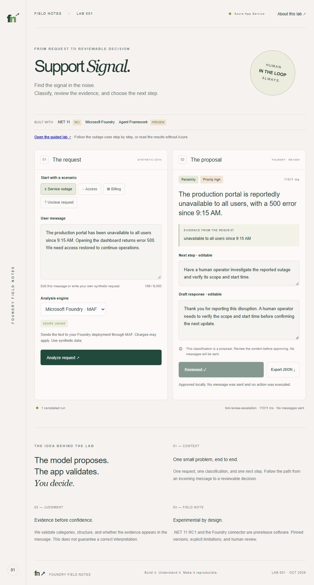

# Lab 001: from a support request to human review

**Question:** How can we classify a support request, check the output, and keep a person in control before acting?

You need basic familiarity with JSON. Choose new inference through your own Foundry deployment or a separate 15-minute local exercise with deterministic simulation. Both follow the same outage case, but their engine labels, expected outputs, and evidence are different. Everything uses synthetic data and US English.

## Choose your path

Start with the [local simulation exercise](#local-simulation-exercise-separate) if you do not have Azure access. For new inference, configure [your local app with Foundry](../README.md#run-with-microsoft-foundry) first, or optionally [deploy your own hosted app](azure-deployment.md) after satisfying its shared-platform prerequisites. You do not need access to a maintainer's deployment.

**Verification status (2026-10-14):** Azure deployment, Entra sign-in, managed-identity inference, review, and JSON export were exercised. The separate recorded Azure run below is evidence of that dated run, not a guarantee of the next answer. A later read-only check passed configuration and anonymous redirects; it did not repeat inference.

## Cloud walkthrough (primary)

This walkthrough calls your Foundry deployment, whether the UI runs on localhost or your own Azure host. Complete the appropriate setup above and authorize one billed synthetic request. For a hosted app, use an allowed Microsoft Entra account. This walkthrough does not deploy resources.

1. **Confirm the boundary.** Select **Microsoft Foundry · MAF**. A local app shows **Local development** and uses your Azure CLI identity. A hosted app requires sign-in, shows **Azure App Service**, and disables simulation. Foundry serves the model in both cases; App Service hosting is optional. Stop if the page does not match your intended environment.
2. **Predict, then ask.** Select **Service outage**. Before analyzing, distinguish the requester's report from a verified incident: neither the cause nor a recovery time is known. Click **Analyze request** once. A live failure must remain an error; do not substitute simulation and call it a successful Foundry run.
3. **Inspect, do not just admire.** Check category, proposed priority, and whether the evidence appears verbatim in the input. Open **Inspect this decision** for the application checks and review policy, then its **Technical details** for the input and original JSON. Read the summary and suggested action for unsupported claims. Reliability / High was observed in the dated run, but exact prose can vary. Valid JSON and an exact quote do not establish a correct interpretation.
4. **Exercise the review boundary.** Edit the reply to acknowledge the report without promising a cause or recovery time. Approve it, edit it again, and verify approval clears. Reapprove and export JSON. Confirm that the original proposal and human edits remain separate and that the export says `mode: foundry`. Nothing is sent to a customer.
5. **Explain what ran.** The application called a code-defined MAF agent backed by Foundry inference, using Azure CLI credentials locally or managed identity when hosted. It did not provision a hosted agent or execute a tool. Record the actual outcome and any correction; do not substitute the historical screenshot as evidence of your run.

**Checkpoint:** What does the application prove, and what still requires judgment? It enforces structure, evidence membership, and review invalidation; a person still evaluates whether the interpretation and proposed response are appropriate. Approval is browser state, not a durable audit record.

Stop here for the cloud walkthrough. Continue below only for the separate local exercise; it does not execute MAF or call Foundry.

## Local simulation exercise (separate)

Follow each Action and compare the deterministic result. Install the SDK pinned in the repository's `global.json` from the [Microsoft .NET downloads](https://dotnet.microsoft.com/en-us/download/dotnet/11.0?wt.mc_id=AI-MVP-5004753). PowerShell 7 runs the helper scripts. From the repository root:

```powershell
./scripts/Test-Prerequisites.ps1
./Start-Demo.ps1 -Lab 1 -Offline
```

Open http://localhost:5187. Choose **Local simulation**. The explicit `-Offline` switch disables live model configuration for this process, even if the terminal has Foundry variables. It uses deterministic rules, no credentials, no cloud calls, and no MAF execution. Package restore may still need internet access. Stop the server with Ctrl+C when finished.

**Read the walkthrough:** follow the input, result table, screenshot, and export excerpt below. These document simulation behavior, not measured AI quality. Variable IDs, timestamps, and latency are deliberately omitted from the excerpts.

Pinned baseline: .NET SDK `11.0.100-rc.1.26425.128` (RC1) and `Microsoft.Agents.AI.Foundry` `1.24.0-preview.261006.1` (preview). This guide does not upgrade those dependencies or claim they will remain the latest.

### 1. Predict before running

**Objective:** separate what the requester reports from what the support team has verified.

**Action:** select **Service outage**. Read this exact fixture:

```text
The production portal has been unavailable to all users since 9:15 AM. Opening the dashboard returns error 500. We need access restored to continue operations.
```

**Predict:** Which category fits: Access, Billing, Reliability, or General? Is the cause known? Does the message prove that every user is affected?

**Interpretation:** the user reports an outage affecting everyone. We still have to verify scope. Neither a database failure nor a resolution time appears in the input.

**Code:** `samples/01-support-signal/src/SupportSignal/wwwroot/app.js`, `scenarios.outage` owns the fixture. `Program.cs`, `Triage.Instructions` tells the live agent to acknowledge uncertainty. Instructions are guidance to the model, not proof that it obeys them.

### 2. Analyze and inspect the proposal

**Action:** confirm **Local simulation** in the engine selector above the request, then click **Analyze request**. The execution strip must identify deterministic rules, not Foundry inference.

| Field | Expected simulation result | What it means |
| --- | --- | --- |
| Category | Reliability | The rules find outage-related words. |
| Priority | High | Reliability plus `production` or `all users` triggers High. |
| Summary | Possible service disruption; scope not yet verified. | A report is not a confirmed diagnosis. |
| Evidence | The entire fixture above | It is under 180 characters; the simulator copies up to 180. |
| Next step | Verify service status and scope before escalating to the on-call team. | A suggestion for a person; no escalation occurs. |
| Engine label | SIMULATION · REVIEW | This is not a Foundry response. |

The draft reply thanks the requester, repeats the suggested step, and states that the cause and resolution timeline have not been confirmed.



**Checkpoint:** Why does the summary say “possible” even though priority is High? Priority is a triage rule; it does not verify the incident.

**Code:** `Program.cs`, `Triage.Simulate` implements these exact rules. Live output can differ; do not use this table as an exact-output assertion for a model.

### 3. Follow the validation boundary

**Action:** open **Inspect this decision** for the readable checks and policy. Its nested **Technical details** retains the input and original response before edits. Inspect `Triage.Validate` in `Program.cs`; it runs after either provider returns a proposal. Processing time is secondary under **Run details**, not a model-quality or latency benchmark.

| Application check | Rejects | Does not establish |
| --- | --- | --- |
| Allowed category and priority | An unsupported label | Correct classification |
| Required text, at most 3,000 characters per field | Missing, empty, or oversized text | A useful or safe recommendation |
| Evidence occurs verbatim in the request | An invented quotation | That the quotation supports the interpretation |

An invalid provider result produces an error, not a simulated replacement. The request itself must be 15–6,000 characters. The UI renders output as text.

**Optional action:** with the pinned SDK available, run the offline contract checks from the repository root:

```powershell
dotnet run --project samples/01-support-signal/tests/SupportSignal.Checks
```

The current baseline reports `11 provider-contract checks passed; no model called.` It covers credential selection, invented evidence, unknown labels, empty or oversized fields, malformed JSON, null output, and missing fields. This is not an adversarial-model evaluation.

**Checkpoint:** Could a wrong interpretation pass all these checks? Yes. An exact quote and valid JSON can still accompany a wrong conclusion.

### 4. Review, edit, approve, and export

**Action:** replace the draft response with:

```text
Thank you for reporting this. We will verify the portal status and affected users before confirming the scope. We do not yet have a confirmed cause or recovery time.
```

Click **Approve proposal**. Expected status: `Approved locally. No message was sent and no action was executed.` Now append ` We will share an update after verification.` to the response. Expected status: `Proposal edited: review is required again.` Approve again and choose **Export JSON**.

The download preserves the original proposal and the edited fields separately. This excerpt is shortened for reading; the actual file also contains the input, ID, timings, and timestamps:

```json
{
  "mode": "simulation",
  "model": "deterministic-rules-v1",
  "requiresHumanReview": true,
  "proposal": { "category": "Reliability", "priority": "High" },
  "reviewed": true,
  "humanEdits": {
    "nextStep": "Verify service status and scope before escalating to the on-call team.",
    "draftReply": "Thank you for reporting this. We will verify the portal status and affected users before confirming the scope. We do not yet have a confirmed cause or recovery time. We will share an update after verification."
  }
}
```

**Interpretation:** `requiresHumanReview` describes the workflow; `reviewed` records the local UI decision. Reloading loses the browser state. Approval is not authenticated, persistent, or an instruction to contact someone. The exported file contains the request and response, so use synthetic data.

**Code:** `app.js`, `unapprove` clears approval after edits; the export handler retains `proposal` and adds `humanEdits`.

### 5. Understand where MAF belongs

```text
Browser → POST /api/analyze
  simulation → Triage.Simulate
  foundry    → AIProjectClient.AsAIAgent → RunAsync → Foundry Responses
Both paths → Parse where needed → Triage.Validate → Browser review → Local export
```

In live mode, MAF supplies the agent abstraction and execution interface. This sample creates a code-defined agent with instructions and calls `RunAsync`; it does not create a hosted agent resource. Foundry serves inference. Our application owns parsing, validation, and browser approval. See Microsoft's [Foundry provider integration](https://learn.microsoft.com/en-us/agent-framework/integrations/by-component/model-providers/microsoft-foundry?wt.mc_id=AI-MVP-5004753), accessed 2026-10-14.

This example uses no tools, conversation history, or multi-agent orchestration. Our design recommendation: learn the single-agent boundary first; direct model inference is also a reasonable alternative for a one-shot classification. The human-review buttons here are application code, not MAF tool approval.

### 6. Change one rule and explain the result

**Predict:** Will removing the reported production-wide scope change category or priority?

**Action:** replace the request with this controlled variation, keep simulation selected, and analyze again:

```text
The test portal is unavailable in my browser. Opening the dashboard returns error 500.
```

**Expected:** Reliability / Priority medium. The outage keywords remain, but neither `production` nor `all users` is present. Editing the input clears the previous proposal; a new analysis is required.

**Exercise:** in `Triage.Simulate`, change the High-priority condition to require both `production` and `all users` instead of either one. Stop and restart after editing, then try `The production portal is unavailable in my browser.` Before the change it is High; afterward it is Medium. Restore the original rule when done. This changes only simulation; live instructions and model behavior are separate.

**Reflection:** Is that stricter rule appropriate for your support team? That is a policy decision to test with representative labeled requests, not something this demo proves.

## Recorded Azure run and evidence limits

On 2026-10-14, an allowed owner signed in to the deployed App Service application. The Service outage fixture was analyzed through MAF and Foundry using the app's managed identity and the shared `bid-review-escalation` deployment. Simulation was disabled. The first attempt timed out during a shared-plan restart; the next attempt succeeded.

| Observation | Recorded result |
| --- | --- |
| Mode | `foundry` |
| Model | gpt-6-luna version 2026-09-22 behind the shared `bid-review-escalation` deployment, as recorded when Lab 002 created it |
| Classification | Reliability / High |
| Evidence | `unavailable to all users since 9:15 AM` |
| Summary | The production portal is reportedly unavailable to all users, with a 500 error since 9:15 AM. |
| Application processing time | 11,011 ms for this successful request |
| Human review | Approve → edit draft reply → approval cleared → approve again → export |
| Export | Original model proposal retained; human edits separate; `reviewed: true` and timestamps present |



The reviewed reply was: “Thank you for reporting this disruption. A human operator needs to verify the scope and start time before confirming the next update.” It replaced only the editable response; the export retained the original model reply. Nothing was sent to a customer or an operations system.

**Checkpoint:** The evidence is an exact substring, but does that establish that an outage really occurred? No: it establishes what the synthetic requester said. A human still needs to verify scope and cause. One successful run is integration evidence, not a quality, cost, or latency benchmark. Exact model prose can vary, and disallowed-user access has not been separately exercised.

Use the deployed cloud lab for live inference; consult the sample's verification record for actual run evidence. For optional local development with an authorized deployment, follow the sample README for `FOUNDRY_PROJECT_ENDPOINT` and `FOUNDRY_MODEL`; placeholders are not real resources. The server uses managed identity in Azure and `AzureCliCredential` locally. Microsoft documents [developer-account authentication](https://learn.microsoft.com/en-us/dotnet/azure/sdk/authentication/local-development-dev-accounts?wt.mc_id=AI-MVP-5004753), accessed 2026-10-14.

When authorized, select **Microsoft Foundry · MAF**, rerun the same fixture, and record date, deployment/model version, mode, output, validation outcome, and human corrections. Do not include credentials. An enabled dropdown confirms configuration only; it does not prove access. Live failure remains an error. Do not label simulation screenshots as live evidence.

## Troubleshooting and completion

### Code map

- [Program.cs](../src/SupportSignal/Program.cs): API, MAF call, simulation, and validation.
- [app.js](../src/SupportSignal/wwwroot/app.js): scenarios, approval state, edits, and export.
- [Contract checks](../tests/SupportSignal.Checks/Program.cs): invalid provider-output cases.

Browser-guide source links open GitHub and require internet access; local source files are also available in your checkout. Reading this included walkthrough and running simulation do not require GitHub sign-in once dependencies are available.

- Server will not start: run `scripts/Test-Prerequisites.ps1`, install the pinned SDK if needed, and check that port 5187 is available. `Start-Demo.ps1 -Lab 1 -Port 5188 -Offline` selects another port for the local simulation exercise.
- Foundry disabled: use simulation for this walkthrough; configuration and live authorization are separate prerequisites.
- No result after editing input: expected; click Analyze request again.
- Approval disappears after editing output: expected; review the new text and approve again.

You have completed the walkthrough when you can explain the Reliability/High result, identify a limitation of evidence validation, demonstrate reapproval after edits, and distinguish MAF's responsibility from the app's. Next: ambiguous requests and adversarial input, with separately measured results.
