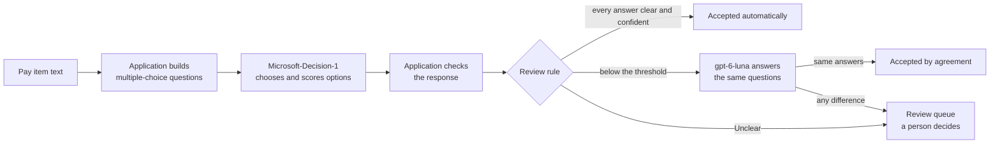

# Bid Review Queue, explained

A short guide for anyone who wants to understand what this lab does and why, without reading the code first. For setup, see the [README](../README.md).

**The platform is Microsoft Foundry.** This lab shows one way to use it: deploy a decision model, call it with a bounded contract, and optionally ask a generative model about uncertain answers. Foundry supplies inference; App Service hosts the app; our code owns the questions, validation, review policy, and export. For the request/response walkthrough and the meaning of the probabilities, read [Microsoft-Decision-1 in Foundry](decision-model.md).

## In one sentence

The application asks an AI model a set of multiple-choice questions about each line of a bid, uses the model's probabilities to decide which lines can follow an automatic rule, asks a second model about the doubtful ones, and sends the rest to a person, starting with the ones that matter most.

## The problem

A contractor bidding on a public works project, such as new sewer and water lines for a town, receives a **bid form**: a list of **pay items**. Each pay item is one line of work with a description, a unit, a quantity and a price, for example:

> `8" PVC SDR-26 Gravity Sanitary Sewer, 6'-8' Depth, Furnish and Install` — 1,365 LF at $142.00

Before an estimator can price the job, every line has to be understood: which utility system it belongs to, what kind of work it pays for, and, when the text mentions them, the pipe size, the material and the depth range. A form can have dozens or hundreds of lines and the deadline is usually close. Most lines are routine. A few are ambiguous, and a mistake on an expensive line is costly.

The real question is not "can AI read this line?" but **"which lines can I trust to an automatic rule, and which need a person?"**

## How it works

There are three separate responsibilities:

1. **The application writes the questions and every possible answer.** "Which utility system is this?" has six fixed answers, including **Unclear**. For sizes, materials and depth ranges, the possible answers are pieces of text copied from the line itself, plus **None of these**. In the example above, the size options are exactly `8"` and none. The model can pick an option; it cannot invent or retype a number.
2. **Microsoft-Decision-1 chooses.** This Microsoft Foundry model is built for decisions, not conversation. For each question it returns the chosen option and a probability for every option, such as 0.98 for sanitary sewer and 0.01 for water. It does not write explanations.
3. **The application applies a review rule, and a person has the last word.** A line is accepted automatically only when every answer is at or above the threshold (90% by default), none is Unclear, and each chosen option is the most probable one. Everything else goes to the review queue. A reviewer can change any answer; a changed line always needs explicit approval.

Think of it as a multiple-choice test with a review desk: the application writes the test, the model answers it, and the rule decides which answer sheets go to the desk.

## A second opinion before the desk

Below the threshold, the first model is unsure, but not necessarily wrong. With the second opinion on, those lines get the same test from a different kind of model, **gpt-6-luna**, a fast general-purpose model in the same Foundry resource. Its answer sheet can only contain the options the application offered. If it picks the same option for every question, the line is **accepted by agreement**. If it picks anything different, the line goes to the desk, and the reviewer sees both answers side by side.

Three things never change: a line the rule already accepted is not sent to the second model, an Unclear answer always goes to a person, and a line a reviewer edited always needs approval. Agreement is not proof: two models can be wrong in the same way, which is why the lab measures how often that happens.

## What the numbers mean

- **Probability.** How likely the model considers each option. It is useful only if it is *calibrated*: answers given at 0.90 should be right about nine times out of ten. Calibration has to be measured on your own data; this lab includes a command that does that.
- **Threshold.** The rule's bar. Moving it changes how many lines go to a person without calling the model again. A lower bar means less review work and more risk; there is no universally correct value.
- **Unclear and None.** Ways for the model to abstain. Unclear always sends the line to a person.
- **Review priority score.** The order of the queue: line amount × (1 − the weakest answer's probability). It puts expensive, uncertain lines first. It is a sorting heuristic, not a prediction of money lost.

## Two ways to run it

| Engine | What happens | When to use it |
| --- | --- | --- |
| Microsoft-Decision-1 | Live requests to your own Foundry deployment, plus live gpt-6-luna requests for doubtful lines when the second opinion is on. | See and measure the real models. Each request is billed by tokens. |
| Recorded run | Replays the real responses of both models saved from live runs of the demo form on 2026-10-14 and checks them again. It ships with the sample. | Try the lab without Azure, or demo without network access. It shows past results and cannot decide new items. |

Both engines show real model answers, and the page always says which one you are looking at. Without Azure settings, the recorded run is selected.

## What we measured

On 2026-10-14, Microsoft-Decision-1 (a preview model) answered 99 synthetic pay items with labels written for this lab:

- Size and depth range were always right; system and work type were right 98 times out of 99; material 29 out of 30.
- With the 90% rule, 68 of 99 lines were accepted automatically, and none of them was wrong. The three lines with an answer that differed from the labels all had low probabilities, so all three went to review.
- Reversing the order of every option list changed none of the 291 answers.
- A typical request took about a quarter of a second, and one pass over the 99 items cost about two tenths of a cent at Microsoft's announced price.
- With the second opinion, 93 of 99 lines needed no review at 90%, still with none wrong. On the three lines where Microsoft-Decision-1 differed from the labels, gpt-6-luna chose the labeled answer, so the models disagreed and a person was asked. A gpt-6-luna answer took several seconds instead of a quarter of a second, a few requests failed, and some answers changed between runs.

These are measurements on synthetic data from a single run, not a general benchmark. Real bid documents, other wording and other domains need their own measurement. Details are in [verification](verification.md).

## What it is not

- Not an estimating product. It does not price, submit or approve bids, and it does not send messages on anyone's behalf.
- Not a guarantee. A 90% rule is an example; it must be validated with labeled examples from the real workload.
- Not an explanation engine. The review reasons come from the application's rule, not from the model explaining itself.
- Not production-ready. It keeps no durable audit trail, and approvals last only until the page is reloaded.

## Where the data goes

In live mode, each line's number, description and unit are sent to the Foundry deployments you configured: Microsoft-Decision-1 for every line, gpt-6-luna only for doubtful lines. Quantities and prices never leave the application. The recorded run makes no model calls. When the lab is hosted in Azure, only the person who deployed it can sign in, and the app reaches the model with its own managed identity instead of keys. Use synthetic or non-confidential data.

## Why this design

- **A decision model instead of a chat model.** Each line needs a few bounded choices, and the application needs numbers it can compare with a threshold. A generative model is the better tool when you need text written, summarized or explained.
- **A chat model only as a second opinion.** gpt-6-luna is slower per line than Microsoft-Decision-1 and returns a choice without probabilities, so it checks the doubtful lines instead of deciding all of them. Strict structured outputs keep it inside the same offered options.
- **No agent framework.** Each line is one decision with no tools, memory or multi-step plan. Agents and tools add value when a problem needs orchestration; [Lab 001](../../01-support-signal/README.md) shows that path.
- **Options built by code.** Copying the possible values from the text removes a whole class of errors, such as a transposed digit. Choosing the wrong offered value is still possible, which is why the review rule exists.

The same pattern works for support ticket routing, document classification, incident triage or content moderation: define the allowed answers, validate the response, apply a review rule, and measure it on your own examples.

## Try it yourself

Begin with the engine and run controls, then the highlighted item 13 case. Open **Policy and optional experiments** for the threshold and option-order controls, **Full bid form** for the dataset/upload, and **Operational details** for historical latency and cost. Primary metrics show accepted-by-rule and accepted-by-agreement counts separately; neither is a correctness claim.

1. **Change the rule.** Decide every pay item at 90%, then predict how many lines will need review at 60% and move the slider. No new model calls are made.
2. **Ask a second model.** With the second opinion on, find *Sanitary Sewer Bypass Pumping*: Microsoft-Decision-1 said force main at 0.71, gpt-6-luna said sanitary gravity, so a person decides. Then open *Accepted by agreement* and look at the lines both models agreed on.
3. **Challenge an answer.** Open an accepted line, change an answer to Unclear, and watch it return to review. Only your approval clears it.
4. **Test option order.** Turn on *Reverse every option list* and run again. Live runs are billed, and one unchanged comparison does not prove robustness.
5. **Inspect a decision.** Open *Inspect this decision* on any card for a readable explanation of the input, original choices, checks, and application route. Expand *HTTP request and response* for the JSON exchanged with Foundry, and *Technical details* for the application's validated view. Follow the model-walkthrough link for the complete Foundry explanation.

## Words used in this lab

- **Bid form (bid schedule):** the list of work items a contractor prices to bid on a project.
- **Pay item:** one line of that list, paid at a unit price (per foot, each, lump sum).
- **Force main:** a pressurized sewer pipe fed by a pump station, as opposed to a gravity sewer.
- **Depth band:** a depth range in which pipe is paid at a given price, such as 6 to 8 feet.
- **Calibration:** how well probabilities match how often answers are actually right.
- **Brier score:** an error measure for probabilities; 0 is perfect and confident mistakes cost the most.
- **Managed identity:** an identity Azure gives an application so it can call other services without stored keys.

## Common questions

- **Is the model generally available?** No. The Azure model catalog listed Microsoft-Decision-1 as preview on 2026-10-14. The lab also runs on .NET 11, which is a release candidate.
- **Why not plain rules?** Rules are a good baseline when the wording is predictable. A model is worth it when the wording varies more than rules can follow; measure both on your data.
- **Can it read PDFs or drawings?** No. Microsoft-Decision-1 takes text only. Extracting text from documents is a separate step this lab does not cover.
- **What does it cost?** Local replay makes no model calls and incurs no Azure inference charges. Local live runs still incur inference charges. Live decisions are billed by input tokens, and second opinions by input and output tokens; on 2026-10-14 a full demo run with second opinions came to well under one cent at list prices. Hosting is separate: fresh deployments default to quota-limited F1, but hosting both labs exceeded that quota, so the two-lab platform uses paid B1. See [platform cost and cleanup](../../../docs/shared-azure-platform.md).
- **Why does the second opinion take longer?** gpt-6-luna is a general model that reasons briefly before answering. On 2026-10-14 its median answer took about 9 seconds, with some close to a minute. The recorded run shows the same answers instantly.

## Learn more

- [README](../README.md): setup, live path, Azure deployment, costs and cleanup.
- [Architecture](architecture.md): components, response contract and hosting.
- [Demo script](demo-script.md): a five-minute presentation.
- [Verification](verification.md): what was measured, and what was not.
- [Sources](sources.md): the Microsoft documentation behind each technical claim.
